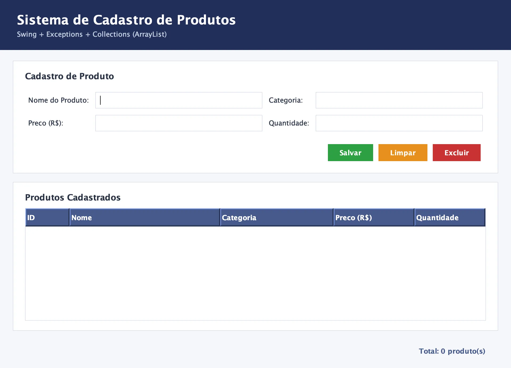
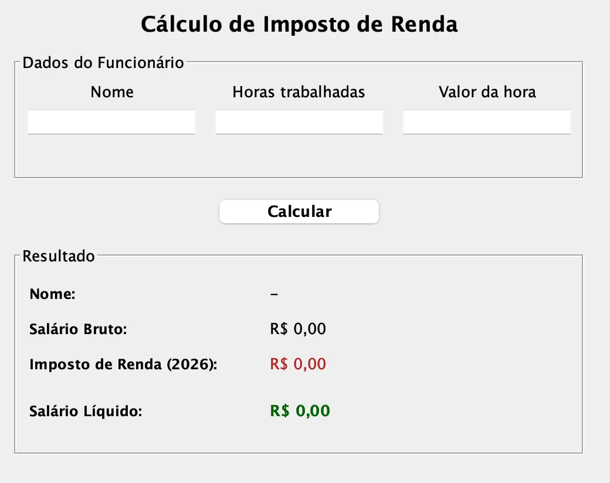

# Estudos Java

Exercícios e pequenos projetos em Java feitos durante a graduação em Análise e Desenvolvimento de Sistemas (Senac PR), organizados por tema: do primeiro `Scanner` até telas Swing com exceções e coleções.

| Cadastro de produtos (Swing + exceções) | Cálculo de IR (Swing) |
|---|---|
|  |  |

## Conteúdo

| Pasta | Tema | Destaques |
|---|---|---|
| `01-fundamentos/` | Variáveis, condicionais, entrada e saída | média, aprovação, maioridade, desconto |
| `02-poo/adega-heranca/` | Herança | `Bebida` → `Vinho`, `Espumante`, `Uisque` |
| `02-poo/sistema-hospitalar/` | Polimorfismo e abstração | `Profissional` → `Medico`, `Enfermeiro`, `TecnicoLaboratorio` |
| `02-poo/heranca-rh/` | Herança aplicada a RH | `Empregado` → `Gerente`, `Desenvolvedor`, `Estagiario`, folha de pagamento |
| `02-poo/exemplos-classes/` | Classes, atributos, métodos | `Professor`, `Aluno`, `Livro`, `Produto` |
| `03-interfaces/` | Interfaces gráficas Swing | calculadora, calculadora de IMC |
| `04-arrays-e-strings/` | Arrays, matrizes, `String` | busca, maior valor, análise de cadastro |
| `05-exercicios/lista-1/` | Lista de exercícios | 24 exercícios + `Main` |
| `05-exercicios/lista-2/` | Lista de exercícios | 14 exercícios + `Main` |
| `05-exercicios/exercicios-livro/` | Exercícios de livro | primos, progressão, peso na Lua, tabela polegada → metro |
| `06-gui-awt/` | AWT | bloco de notas, lista de tarefas |
| `07-projetos/sistema-cadastro-produtos/` | Aula 09: Swing, exceções e coleções | CRUD em `ArrayList` com `ProdutoInvalidoException` (tem README próprio) |
| `07-projetos/calculo-imposto-renda/` | Swing | salário bruto por horas, IR pela tabela progressiva, salário líquido |
| `07-projetos/gerador-equipes/` | Swing + `Random` | gera nomes aleatórios de equipes |

## Como rodar

Requer JDK 17 ou superior. Quase todos os arquivos declaram `package` (`PrimeiraAula`, `Sistema`, `exercicios`...), então compile a pasta para um diretório de saída e rode pelo nome completo da classe:

```bash
# exemplo: herança da adega
javac -encoding UTF-8 -d out 02-poo/adega-heranca/src/*.java
java -cp out Sistema.Adega

# exemplo: lista 1
javac -encoding UTF-8 -d out 05-exercicios/lista-1/src/*.java
java -cp out exercicios.Main

# exemplo: cálculo de IR (abre uma janela)
javac -encoding UTF-8 -d out 07-projetos/calculo-imposto-renda/src/*.java
java -cp out ImpostoRenda.CalcImposto
```

Para descobrir o pacote de um arquivo: `head -1 caminho/Arquivo.java`. As pastas foram criadas no Eclipse; também dá para importar cada uma como projeto Java.

Observação: `03-interfaces/src/TelaPrincipal/Main.java` não compila (`import javax.Swing.*` com S maiúsculo). As outras classes da pasta compilam se ela ficar de fora.

## Licença

MIT © [Pedro Szpak](https://github.com/PeSzpak)
